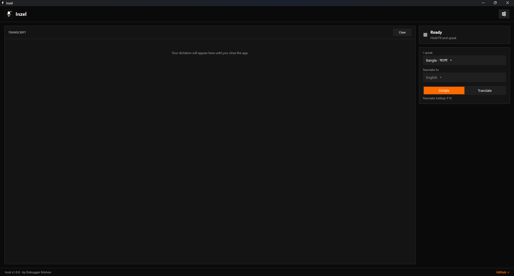
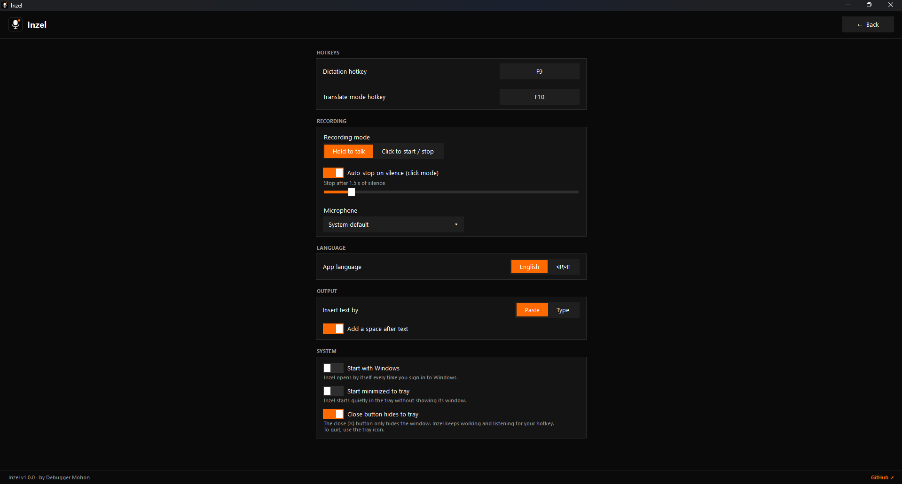

<div align="center">


# Inzel

**Push-to-talk voice typing and translator for Windows.**
Hold a key, speak in any of 39 languages, and the text appears at your cursor, in any app.

Free · Open source · No account · No API key · Written in Rust

[](LICENSE)
[](#download--install)
[](https://www.rust-lang.org)
[](https://github.com/DebuggerMohon/Inzel/releases/latest)
[](https://github.com/DebuggerMohon/Inzel/releases)

[**Download**](https://github.com/DebuggerMohon/Inzel/releases/latest) ·
[How to use](#how-to-use) ·
[Build from source](#build-from-source) ·
[Contributing](CONTRIBUTING.md)

</div>

---

## Screenshots

<p align="center">
  
  
</p>

## What it does

1. Click into any text field: a browser, Word, a chat app, a code editor.
2. **Hold `F9`** and speak.
3. Release the key. Your words are typed where the cursor is.

Turn on **Translate mode** (`F10`) and Inzel types the translation instead.
For example, speak Bangla and get English text, or any other pair of the 39 languages.

## Features

- **Types anywhere:** works in any app that accepts text.
- **39 languages** for speaking and translating, including Bangla, English, Hindi, Urdu, Arabic, Spanish, French, German, Chinese, Japanese and more.
- **Translate mode:** speak language A, get text in language B, with its own hotkey.
- **Auto-detect** between two languages.
- **Hold to talk** or **click to start / click to stop**, with auto-stop after a pause (1 to 6 seconds, adjustable).
- **Recording bar:** a small always-on-top bar with a live level meter that never steals focus.
- **Transcript history** with copy buttons, kept until you close the app.
- **Your choices:** custom hotkeys, microphone selection, paste or type output, optional trailing space.
- **Tray icon**, start with Windows, start minimized.
- **Interface in English and বাংলা.** Other languages are translated automatically on first use.
- **Tiny and fast:** native Win32 app, a single `.exe`, low memory use.
- **Private by design:** no account, no API key, no telemetry.

## Download & install

1. Open the [**Releases**](https://github.com/DebuggerMohon/Inzel/releases/latest) page.
2. Download `Inzel-Setup-x.y.z.exe` and run it: **Next → Next → Install → Finish**.

> **SmartScreen** may show "Windows protected your PC" because the installer is not code-signed yet.
> Click **More info → Run anyway**, or build it yourself from source (below).

## How to use

| Action | Default key |
|---|---|
| Dictate (hold, speak, release) | `F9` |
| Toggle Translate mode | `F10` |

- Pick your languages on the home page: **I speak** and **Translate to**.
- Switch between **Dictate** and **Translate** with the buttons on the home page or the hotkey.
- Open **Settings** (top right) to change hotkeys, recording mode, microphone, output method and app language.
- Closing the window hides Inzel to the tray. Right-click the tray icon and choose **Quit** to exit.
- Settings are stored in `%APPDATA%\Inzel\config.json`.

## Troubleshooting

| Problem | What to try |
|---|---|
| Nothing is typed | Check your internet connection. Speech recognition needs it. Also check the microphone in Settings. |
| Doesn't type into some windows | Windows running as administrator ignore normal apps. Run Inzel as administrator too. |
| "No speech detected" | Speak closer to the microphone or choose another microphone in Settings. |
| Wrong language recognized | Set **I speak** to your exact language instead of Auto-detect. |
| SmartScreen warning | The app is not code-signed yet. Click **More info → Run anyway**, or build from source. |

## Privacy

No server, no telemetry. While you dictate, audio is sent to Google's speech recognition endpoint.
With Translate mode on, the text is sent to Google Translate. Nothing is stored anywhere except your settings file.
The recognition engine is one small file (`src/stt.rs`) that can be replaced by an offline engine.

Inzel uses Google's free web endpoints, which are unofficial. They may be rate-limited or change in the future.

## Build from source

You need Windows 10/11, [Rust](https://rustup.rs) (stable, MSVC toolchain) and the
**"Desktop development with C++"** workload of [Visual Studio Build Tools](https://visualstudio.microsoft.com/visual-cpp-build-tools/).

```bat
git clone https://github.com/DebuggerMohon/Inzel.git
cd Inzel
cargo run --release          :: run it
.\build.bat                  :: exe + installer (needs Inno Setup 6/7)
```

Output: `target\release\Inzel.exe` and `installer\Inzel-Setup-x.y.z.exe`.
Pushing a tag like `v1.0.0` builds the installer on GitHub Actions and attaches it to a Release.

## Project structure

```
src/main.rs        entry point
src/ui.rs          main window, pages, popups (GDI, immediate-mode)
src/gfx.rs         tiny GDI toolkit (rects, text, fonts, off-screen canvas)
src/overlay.rs     recording bar
src/engine.rs      record -> transcribe -> (translate) -> insert
src/audio.rs       microphone (cpal/WASAPI), level meter, auto-stop, segment splitting
src/stt.rs         speech recognition (Google) + minimal FLAC encoder
src/translate.rs   Google Translate
src/hotkeys.rs     global low-level keyboard hook
src/inject.rs      paste / type into the focused window
src/tray.rs, system.rs, config.rs, i18n.rs, languages.rs, theme.rs
locales/           en.json, bn.json (embedded in the exe)
assets/            icon and screenshots
```

## Contributing

Bug reports, ideas and pull requests are welcome. See [CONTRIBUTING.md](CONTRIBUTING.md).

Ideas: offline Whisper or Vosk engine, spoken punctuation, per-app profiles, custom vocabulary.

If Inzel is useful to you, a ⭐ on the repository helps others find it.

## License

[MIT](LICENSE) © 2026 Debugger Mohon
